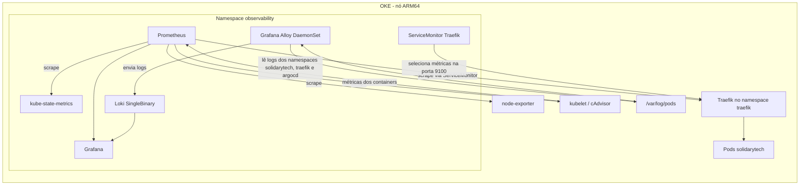
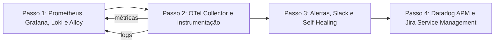

# SolidaryTech — Arquitetura e Uso da Observabilidade

## 1. Escopo e estado da validação

Este guia descreve a configuração do Passo 1 do ACP-002 presente no repositório: Prometheus, Grafana, Loki, Grafana Alloy e métricas do Traefik no namespace `observability`.

Os manifests e charts foram renderizados localmente. A implantação, os pods, os targets e a saúde dos recursos no OKE não foram verificados nesta atualização; não se deve interpretar a configuração versionada como confirmação de que o cluster está operacional.

| Chart ou release | Versão fixada |
|---|---:|
| kube-prometheus-stack | 93.11.0 |
| prometheus-operator-crds | 33.0.2 (`appVersion v0.95.2`) |
| Loki | 7.7.0 |
| Grafana Alloy | 1.16.0 |
| Traefik | 43.0.0 |

As fontes principais são a [Application ArgoCD](../k8s/argocd/solidarytech-observability-oci.yaml), os [values do kube-prometheus-stack](../k8s/observability/kube-prometheus-stack-values.yaml), os [values do Loki](../k8s/observability/loki-values.yaml), os [values do Alloy](../k8s/observability/alloy-values.yaml), o [ServiceMonitor do Traefik](../k8s/observability/traefik-servicemonitor.yaml), o [dashboard provisionado](../k8s/observability/dashboard-solidarytech-overview.yaml) e os scripts de [bootstrap GitOps](../infra/scripts/oci-oke-gitops-bootstrap.sh) e [preflight do OCI Vault](../infra/scripts/oci-secrets-preflight.sh).

## 2. Visão geral e arquitetura implementada

O Node Pool configurado para `oci-prod` usa `VM.Standard.A2.Flex`, arquitetura ARM64, um nó, 2 OCPUs, 12 GB de memória e boot volume de 50 GB. Os componentes da stack com `nodeSelector` nos values estão fixados a Linux ARM64; o comando de instalação do Traefik não define `nodeSelector`.



| Componente | Responsabilidade e configuração |
|---|---|
| Prometheus | Coleta métricas do cluster, do nó, dos Pods e de `ServiceMonitor`; retenção de 2 dias. |
| Grafana | Interface em `/grafana`, datasource Prometheus e datasource Loki; usa Secret existente para as credenciais administrativas. |
| kube-state-metrics | Expõe métricas sobre o estado de objetos Kubernetes, como nós, Pods e workloads. |
| prometheus-node-exporter | Expõe métricas do sistema operacional do nó ARM64. |
| Loki | Instância `SingleBinary`, uma réplica, armazenamento local efêmero e retenção configurada de 48 horas. |
| Grafana Alloy | DaemonSet que lê logs de `/var/log/pods` nos namespaces `solidarytech`, `traefik` e `argocd`, adiciona labels `namespace`, `pod` e `container`, e os envia ao Loki. |
| ServiceMonitor `traefik` | Seleciona o Service Traefik no namespace `traefik` e coleta `/metrics` pela porta nomeada `metrics`, configurada para a porta 9100. |

O Traefik habilita labels de entrypoint. A configuração versionada não habilita explicitamente labels de serviço; portanto, métricas de tráfego por entrypoint são a referência garantida pelo dashboard. Métricas HTTP individuais por microsserviço dependem de a série e o label de serviço serem efetivamente expostos ou da instrumentação planejada no Passo 2.

## 3. Orçamento FinOps e armazenamento efêmero

Os valores abaixo representam requests e limits explicitamente configurados nos values ou no comando Helm do Traefik. Requests são alocações para scheduling; limits são tetos, não consumo garantido.

| Componente | Requests CPU / memória | Limits CPU / memória | Retenção | `emptyDir` |
|---|---|---|---|---:|
| Prometheus Operator | 50m / 128Mi | 200m / 256Mi | — | — |
| Prometheus | 200m / 512Mi | 500m / 1Gi | 2 dias | 4Gi |
| kube-state-metrics | 25m / 64Mi | 100m / 128Mi | — | — |
| node-exporter | 25m / 64Mi | 100m / 128Mi | — | — |
| Grafana | 100m / 256Mi | 250m / 512Mi | — | 1Gi |
| Loki SingleBinary | 100m / 256Mi | 300m / 512Mi | 48 horas | 4Gi |
| Grafana Alloy | 50m / 128Mi | 200m / 256Mi | — | 512Mi |
| Traefik | 100m / 128Mi | Não definido explicitamente pelo bootstrap | — | — |
| **Total explícito** | **650m / 1.536Mi** | **1.650m / 2.816Mi, sem Traefik** | | **9,5Gi** |

O total é uma soma dos recursos configurados para os componentes listados, não uma medição de uso do nó. Não inclui ArgoCD, microsserviços, componentes do sistema, recursos reservados pelo Kubernetes nem requests de sidecars que não estejam explicitados nesses values. A capacidade do nó é bruta; a capacidade `allocatable` será menor.

Os limites de `emptyDir` são tetos de armazenamento efêmero, não reservas de disco. A soma de 9,5Gi pode pressionar o espaço efêmero do nó; esses dados podem ser perdidos quando o Pod ou nó é removido. Loki não usa PVC e não oferece persistência após perda do armazenamento efêmero.

## 4. Segredos e ordem de provisionamento

1. `oci-secrets-preflight.sh` procura `solidarytech-grafana-admin-password` no Vault `solidarytech-vault-prod`. Se estiver ausente, gera uma senha alfanumérica de 20 caracteres e a cria como secret `CURRENT`. Se já existir, preserva o valor.
2. O bootstrap valida o cluster, cria o namespace `observability`, lê a senha do Vault e cria/atualiza o Secret Kubernetes `grafana-admin-secret`, com as chaves `admin-user` e `admin-password`, sem imprimir o conteúdo.
3. Antes de aplicar a Application, o bootstrap verifica os dez CRDs. Se um CRD existente declara a versão `0.95.2` e não pertence a outro release Helm ou Application ArgoCD, o script transfere sua propriedade ao release Helm e remove os marcadores de tracking do ArgoCD. Conflitos ou versões diferentes interrompem o bootstrap sem sobrescrever o proprietário. Em seguida, instala ou atualiza `prometheus-community/prometheus-operator-crds` na versão `33.0.2`; essa versão declara `appVersion v0.95.2`, igual à versão do Prometheus Operator usada pelo kube-prometheus-stack `93.11.0`. O Helm espera os CRDs ficarem estabelecidos antes de continuar.
4. O bootstrap aplica a Application `solidarytech-observability-oci`. O kube-prometheus-stack tem `crds.enabled: false`: a Application não tenta gerenciar os mesmos CRDs que o release Helm separado.

O release dos CRDs é parte da infraestrutura necessária ao Operator. Não o desinstale: a documentação do chart alerta que a remoção pode excluir os CRDs e os recursos customizados dependentes.

Em uma migração de cluster existente, suspenda a sincronização automática com prune da Application antes de publicar a alteração de `crds.enabled` e execute o workflow de bootstrap de forma controlada. A Application atual tem prune automático; se o ArgoCD sincronizar primeiro a remoção dos CRDs do chart principal, poderá removê-los antes da transferência. A migração no OKE não foi executada nem validada nesta atualização.

### Recuperar a senha do Grafana

Use um terminal local e privado com OCI CLI autenticada. Substitua `$VAULT_ID` por um valor obtido por procedimento autorizado; não registre nem compartilhe a saída. Não execute com tracing de shell (`set -x`) e não cole o resultado em logs ou tickets.

```bash
set +x
oci --auth api_key --region sa-saopaulo-1 \
  secrets secret-bundle get-secret-bundle-by-name \
  --vault-id "$VAULT_ID" \
  --secret-name solidarytech-grafana-admin-password \
  --stage CURRENT \
  --query 'data."secret-bundle-content".content' \
  --raw-output | base64 --decode
```

Quando o Load Balancer estiver disponível, acesse `http://<IP_TRAEFIK>/grafana` e use o usuário `admin`. O IP deve ser obtido do sumário do workflow; este guia não contém OCIDs nem valores de credenciais.

## 5. Dashboard e consultas

O dashboard provisionado como `SolidaryTech - Observability Overview` tem três seções:

1. **Saúde e consumo do cluster ARM64:** estado Ready do nó, CPU/memória do nó e uso de CPU/memória dos Pods no namespace `solidarytech`.
2. **Tráfego e erros observados pelo Traefik:** taxa de requests e taxa de respostas HTTP 5xx, agrupadas por entrypoint.
3. **Logs recentes de `solidarytech`:** fluxo de logs do Loki filtrado pelo namespace.

No Grafana, abra **Explore**, selecione Prometheus ou Loki e execute as consultas abaixo. As métricas só retornarão séries quando os respectivos targets estiverem ativos.

### PromQL

Nó Ready:

```promql
sum(kube_node_status_condition{condition="Ready",status="true"})
```

CPU percentual do nó ARM64:

```promql
100 * (1 - avg by (instance) (rate(node_cpu_seconds_total{mode="idle"}[5m])))
and on (instance) node_uname_info{machine=~"aarch64|arm64"}
```

Memória utilizada percentual do nó ARM64:

```promql
100 * (1 - node_memory_MemAvailable_bytes / node_memory_MemTotal_bytes)
and on (instance) node_uname_info{machine=~"aarch64|arm64"}
```

CPU por Pod dos três microsserviços:

```promql
sum by (pod) (
  rate(container_cpu_usage_seconds_total{
    namespace="solidarytech",
    container!=""
  }[5m])
)
```

Memória por Pod dos três microsserviços:

```promql
sum by (pod) (
  container_memory_working_set_bytes{
    namespace="solidarytech",
    container!=""
  }
)
```

Taxa de requests HTTP observada por entrypoint do Traefik:

```promql
sum by (entrypoint) (rate(traefik_entrypoint_requests_total[5m]))
```

Taxa de respostas HTTP 5xx observada por entrypoint:

```promql
sum by (entrypoint) (
  rate(traefik_entrypoint_requests_total{code=~"5.."}[5m])
)
```

Consulta por serviço Traefik, caso a série e o label `service` estejam disponíveis:

```promql
sum by (service) (
  rate(traefik_service_requests_total{
    service=~".*(ngo-service|donation-service|volunteer-service).*"
  }[5m])
)
```

A consulta por serviço pode não retornar dados com a configuração atual, que habilita explicitamente labels de entrypoint, não de serviço. Para métricas HTTP geradas dentro da aplicação, a instrumentação OpenTelemetry está planejada para o Passo 2.

### LogQL

Todos os logs coletados de `solidarytech`:

```logql
{namespace="solidarytech"}
```

Logs de um Pod do `ngo-service`:

```logql
{namespace="solidarytech", pod=~"ngo-service-.*"}
```

Linhas que aparentam conter erros:

```logql
{namespace="solidarytech"} |~ "(?i)(error|exception|panic)"
```

## 6. Checklist de diagnóstico

As consultas a seguir são exemplos de operação para um ambiente autorizado; não foram executadas nesta atualização.

1. No ArgoCD, confirme que `solidarytech-observability-oci` está sincronizada e saudável.
2. Confirme que o release Helm `prometheus-operator-crds` foi concluído e que os CRDs estão `Established`:

   ```bash
   kubectl get crd prometheuses.monitoring.coreos.com servicemonitors.monitoring.coreos.com
   ```

3. Verifique o Operator, o CR Prometheus e o StatefulSet que ele deve reconciliar:

   ```bash
   kubectl -n observability get deployment/kube-prometheus-stack-operator
   kubectl -n observability get prometheus/kube-prometheus-stack-prometheus
   kubectl -n observability get statefulset
   ```

4. Se o StatefulSet não aparecer, examine as conditions do CR, events do namespace e logs do Deployment do Operator. Redija qualquer informação sensível antes de compartilhar logs.
5. No Grafana Explore, execute a consulta do nó Ready e as consultas PromQL acima. Para verificar os targets por uma conexão local autorizada, use:

   ```bash
   kubectl -n observability port-forward svc/kube-prometheus-stack-prometheus-operated 9090:9090
   ```

   Abra `http://localhost:9090/targets`; não exponha o serviço Prometheus publicamente.
6. Confirme que o DaemonSet Alloy tem um Pod Ready por nó, que o Pod Loki está Ready e que `{namespace="solidarytech"}` retorna logs recentes.

## 7. Evolução planejada



| Passo | Incremento planejado | Integração com a base |
|---|---|---|
| 2 | OTel Collector recebe OTLP gRPC `4317` e HTTP `4318`; instrumentação dos serviços Python e Go | Métricas seguem para Prometheus e logs para Loki; melhora a observabilidade por aplicação sem substituir a coleta de infraestrutura. |
| 3 | Alertas para HTTP 5xx, notificações Slack e Self-Healing por GitHub Actions | Regras customizadas consomem métricas da base; ações no cluster devem usar autorização temporária e revogável para TCP/6443. |
| 4 | Datadog APM/Distributed Tracing e Jira Service Management | Exporter Datadog só será ativado nesta etapa; `DD_API_KEY` e outros tokens devem permanecer no OCI Vault. |
