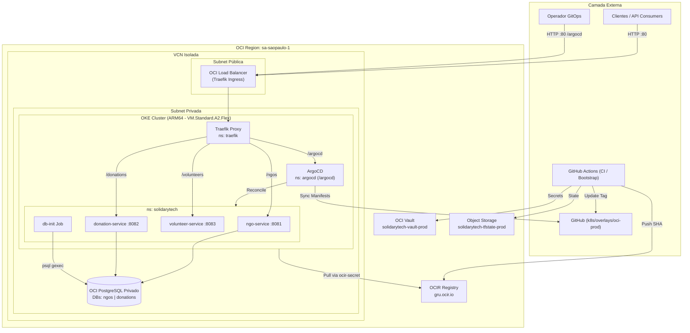
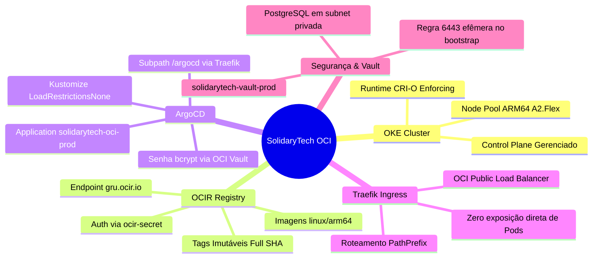
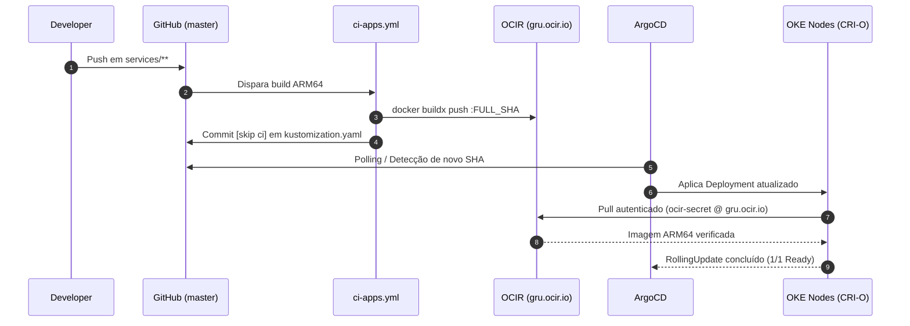
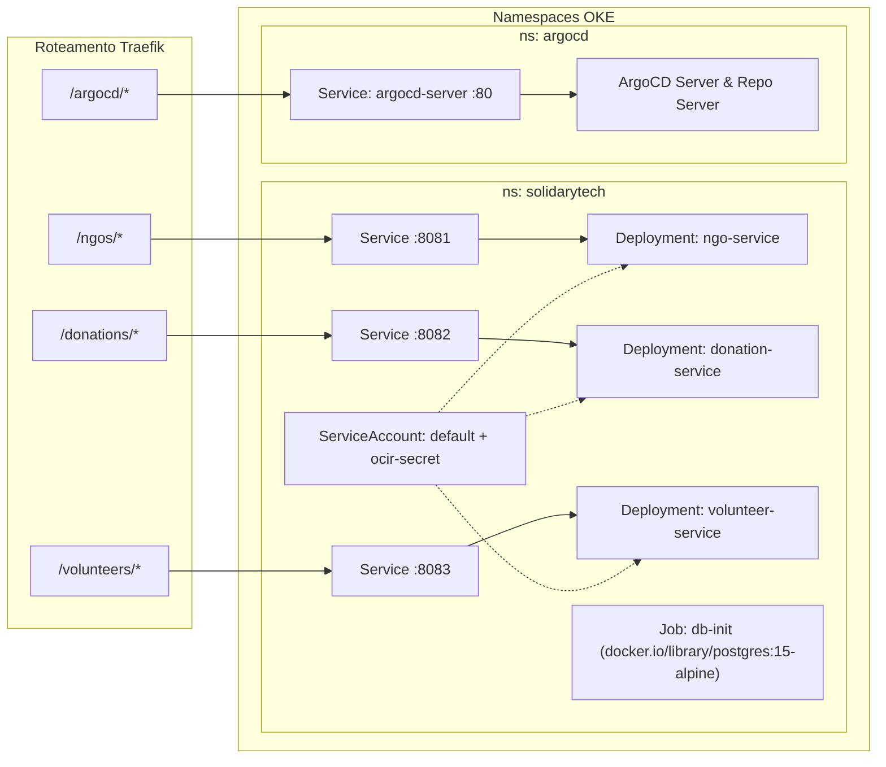
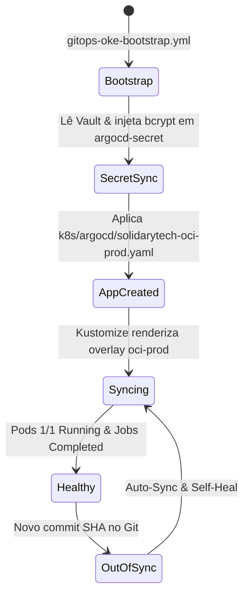

# SolidaryTech — Arquitetura OCI, OKE, OCIR & ArgoCD

**Blueprint Visual da Plataforma Cloud-Native & GitOps na Oracle Cloud Infrastructure (`sa-saopaulo-1`)**

[Topologia](#1-topologia-cloud--kubernetes) •
[Mapa de Componentes](#2-mapa-de-componentes) •
[Fluxo GitOps & OCIR](#3-fluxo-gitops--ocir) •
[Cluster OKE & Workloads](#4-cluster-oke--workloads) •
[Ciclo de Vida ArgoCD](#5-ciclo-de-vida-argocd) •
[Matriz de Segurança](#6-matriz-de-segurança)

## 1. Topologia Cloud & Kubernetes

## 2. Mapa de Componentes

| Domínio | Recurso | Identificador / Endpoint | Função |
| --- | --- | --- | --- |
| **OKE** | Cluster Kubernetes | `solidarytech-oke-cluster` | Orquestração de containers em nós ARM64 (`VM.Standard.A2.Flex`) |
| **OCIR** | Container Registry | `gru.ocir.io/<namespace>/solidarytech/*` | Armazenamento privado de imagens `linux/arm64` com tag `FULL_SHA` |
| **ArgoCD** | GitOps Controller | `solidarytech-oci-prod` (`/argocd`) | Reconciliação contínua entre `k8s/overlays/oci-prod` e o cluster |
| **Ingress** | Traefik + OCI LB | Subnet Pública (`:80`) | Ponto único de entrada HTTP para APIs e interface web do ArgoCD |
| **Vault** | Cofre de Segredos | `solidarytech-vault-prod` | Guarda token OCIR, credenciais PostgreSQL e senha admin do ArgoCD |
| **Dados** | PostgreSQL Privado | Subnet Privada (`:5432`) | Bancos `ngos` e `donations` isolados da internet |

## 3. Fluxo GitOps & OCIR

> [!NOTE]
> **Desacoplamento CI - CD:** O GitHub Actions nunca aplica manifestos de aplicação diretamente no OKE. Ele publica a imagem no **OCIR** (`gru.ocir.io`) e atualiza o SHA no Git; o **ArgoCD** detecta o commit e executa o rollout.

## 4. Cluster OKE & Workloads

### Contratos Técnicos do Runtime OKE

| Regra de Runtime | Configuração Aplicada | Motivo Técnico |
| --- | --- | --- |
| **Fully Qualified Images** | `docker.io/library/...` e `gru.ocir.io/...` | CRI-O no Oracle Linux opera com `short-name-mode = "enforcing"` |
| **Alinhamento OCIR** | `--docker-server=gru.ocir.io` no `ocir-secret` | Kubelet exige correspondência exata entre o host da imagem e o Secret |
| **Histórico Limpo** | `revisionHistoryLimit: 1` nos Deployments | Evita acúmulo de ReplicaSets inativos (`0/0`) no painel do ArgoCD |
| **Gunicorn Non-Root** | `ENV HOME=/tmp` nos Dockerfiles Python | Permite criação do socket de controle do Gunicorn 27 sem privilégios |
| **DB Init Idempotente** | `SELECT ... \gexec` no Job `db-init` | Cria `ngos` e `donations` condicionalmente antes de aplicar schemas |

## 5. Ciclo de Vida ArgoCD

| Parâmetro ArgoCD | Valor Configurado | Onde é Definido |
| --- | --- | --- |
| **Application** | `solidarytech-oci-prod` | `k8s/argocd/solidarytech-oci-prod.yaml` |
| **Source Path** | `k8s/overlays/oci-prod` | `k8s/argocd/solidarytech-oci-prod.yaml` |
| **Root Path Web** | `/argocd` (`configs.params."server.rootpath"`) | `infra/scripts/oci-oke-gitops-bootstrap.sh` |
| **Kustomize Options** | `--load-restrictor LoadRestrictionsNone` | `infra/scripts/oci-oke-gitops-bootstrap.sh` |
| **Admin Password** | Hash `bcrypt` do segredo `solidarytech-argocd-admin-password` | `infra/scripts/oci-oke-gitops-bootstrap.sh` |

## 6. Matriz de Segurança

> [!IMPORTANT]
> **Zero-Trust na API Kubernetes:** A porta `TCP/6443` permanece bloqueada na Security List `solidarytech-sl-public-lb`. Durante o bootstrap ou destroy, o GitHub Actions libera apenas o IPv4 efêmero do runner (`temp-gh-runner-<run_id>-<attempt>`), limpa regras órfãs e revoga o acesso em `if: always()`.

| Camada | Controle Implementado | Evidência no Repositório |
| --- | --- | --- |
| **Segredos** | Zero credenciais no Git ou logs; leitura dinâmica do **OCI Vault** | `infra/scripts/oci-secrets-preflight.sh` |
| **Rede API** | Liberação temporária e autorrevogável de `TCP/6443` por IP do runner | `.github/workflows/gitops-oke-bootstrap.yml` |
| **Banco de Dados** | PostgreSQL isolado em subnet privada sem IP público | `infra/modules/oci/` |
| **Supply Chain** | Imagens privadas no OCIR puxadas por `FULL_SHA` imutável | `k8s/overlays/oci-prod/kustomization.yaml` |
| **Hardening Pods** | `allowPrivilegeEscalation: false` e `capabilities.drop: ["ALL"]` no `db-init` | `k8s/base/db-init-job.yaml` |
| **FinOps & Estado** | Vault e OCIR desacoplados do `terraform destroy` (`removed { destroy = false }`) | `infra/environments/oci-prod/` |